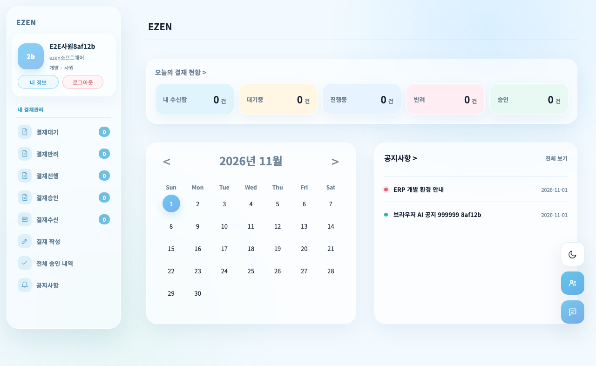
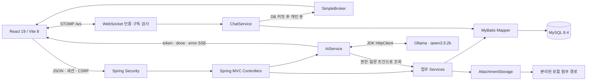

# EZENT ERP

전자결재·공지·사원관리에서 시작해 실시간 메신저와 로컬 AI 업무 도우미로 확장한 Spring Boot·React 프로젝트입니다. 2025년 팀 결과물을 바탕으로, 2026년에는 권한 변경·동시 요청·첨부 정합성을 재현하고 실제 MySQL·WebSocket·브라우저 회귀로 보완했습니다.

## 핵심 성과

1. **업무 규칙을 서버와 DB에서 보장했습니다.** 결재 순서·종결 상태·본인 결재를 검사하고, 결재 처리와 사원번호 발급을 DB 트랜잭션으로 직렬화했습니다. [결재·동시성 설계](docs/refactoring/solo-agent-workflow.md#결재-정책)
2. **계정 변경과 업무 이력을 함께 보호했습니다.** 강등·퇴직 후 기존 로그인과 메신저 연결을 회수하고, 사원 삭제로 결재·대화 이력이 연쇄 삭제되지 않도록 했습니다. [문제 재현·해결·회귀](docs/refactoring/p1-session-approval-history.md)
3. **검증 결과를 원문과 함께 남겼습니다.** 2026-11-01 회귀 84개·브라우저 12개 흐름을 통과했고, 기존 1천 건·3반복에서 API 9,900건·메시지 전달 1,800건·브라우저 360건의 실패가 0건이었습니다. [마감 검증](docs/refactoring/portfolio-readiness.md) · [측정 조건·원문](performance/results/20261022T103945Z-2fe863/README.md)

[2~3분 시연 순서](docs/refactoring/portfolio-demo.md) · [포트폴리오 마감 상태](docs/refactoring/portfolio-readiness.md) · [CI 설정](.github/workflows/ci.yml)



## 기간과 기여 범위

| 구분 | 기간 | 범위 |
|---|---|---|
| 팀 프로젝트 | 2025.03~2025.04 | 전자결재·공지·사원관리의 업무 화면과 DB·기능 구현 |
| 손현아의 개인 개선 | 2026.09~2026.11.01 | Spring Boot·React 전환, Service·Mapper 분리, 인증·권한·동시성·파일 정합성 보완, 메신저·로컬 AI, 격리 회귀·복구 도구·1천 건 측정·문서 정리 |

2025년 팀 구성과 당시 역할은 다음과 같습니다. 개인 개선을 팀 전체의 단독 개발 성과로 표현하지 않습니다.

| 이름 | 당시 역할 | 당시 담당 업무 |
|---|---|---|
| 손현아 | 팀원 | 화면 설계 및 편집, DB 설계, 기능 구현, 프론트엔드·백엔드 개발 |
| 이안나 | 팀장 | 문서 관리 및 총괄, 기능 구현, 프론트엔드·백엔드 개발 |
| 왕석진 | 팀원 | 화면 설계 및 편집, DB 설계, 기능 구현, 프론트엔드·백엔드 개발 |
| 정상윤 | 멘토 | 프로젝트 피드백 및 기술 질의응답 |

개인 개선은 AI 코딩 에이전트의 구현·테스트 작성·독립 검토 보조를 사용했습니다. 파일 소유권을 나누고 통합 담당이 빌드·DB·실행 결과를 대조했습니다. 역할과 수행 범위는 [실제 에이전트 활용 기록](docs/refactoring/solo-agent-workflow.md)에 공개했습니다. 2026-11-01 마감 범위는 부서 변경 후 AI 조회, 키보드·모바일 메뉴, README·시연 자료이며 결과는 각 검증 기록의 기준일을 따릅니다.

## 현재 기능과 구조

| 기능 | 동작 |
|---|---|
| 전자결재 | 기안서·품의서·연차신청서, 결재선 순차 승인·반려, 재상신, 권한 있는 첨부 다운로드 |
| 공지·사원관리 | 관리자 쓰기 권한, 검색·필터·10개 단위 페이지, 사원번호 발급, 재직·퇴직 관리 |
| 메신저 | 1:1 STOMP 송수신, DB 이력, 재접속 복구, 표시한 메시지까지 읽음 처리 |
| AI 업무 도우미 | 질문에 맞는 전사·본인 부서 공지와 현재 본인 순서인 결재를 조회해 로컬 모델로 안내, SSE 응답·오류 표시 |
| 공통 화면 | React 단일 셸, 세션·CSRF, 반응형 레이아웃과 다크 모드 |



Java 21, Spring Boot 4.1.1, Spring Security, MyBatis, MySQL 8.4, React 19, Vite 8을 사용합니다. 앱은 실행 WAR 하나이며 DB와 첨부 경로를 분리합니다. 메신저는 내장 SimpleBroker, AI는 JDK HTTP 클라이언트를 사용합니다. 현재 범위에서 Redis·외부 브로커·벡터 DB를 추가하지 않았습니다.

## 대표 문제 해결

| 문제 → 원인 | 해결과 확인 |
|---|---|
| 관리자를 강등해도 기존 세션의 권한이 남음 → 로그인 시 저장한 인증 상태가 유지됨 | 변경 커밋 뒤 해당 사용자의 세션을 회수합니다. 실제 HTTP·WebSocket 종료, 롤백 시 유지, 같은 쿠키로 다른 계정에 재로그인한 경합을 검증했습니다. [설계·근거](docs/refactoring/p1-session-approval-history.md) |
| 중복 승인·동시 사원 등록이 경합함 → 화면 검사와 번호 미리보기만으로 순서를 보장할 수 없음 | 문서 행 잠금 뒤 현재 결재 권한을 재검사하고, 연도별 번호 행 잠금과 DB 제약으로 발급합니다. 순서 위반·종결 후 처리·중복 발급을 실제 MySQL 회귀로 확인했습니다. [정책·검증](docs/refactoring/solo-agent-workflow.md#결재-정책) |
| 재접속·닫힌 대화창의 읽음 상태가 어긋남 → 구독 준비와 이력 조회, 수신과 화면 표시의 시점이 다름 | 같은 소켓의 구독 완료 신호 뒤 이력을 병합합니다. 현재 보이는 방의 마지막 표시 메시지만 읽음 처리하고, 금지된 송신·구독은 서버에서 거절합니다. [통신 정책](docs/refactoring/solo-agent-workflow.md#메신저-정책) · [읽음·화면 회귀](docs/refactoring/data-usability-performance.md) |

첨부 교체·삭제는 커밋 뒤 참조 없는 파일만 정리합니다. 실패·롤백 시 기존 파일을 보존하며, 공지의 내부 저장 파일명은 서버가 정합니다. [파일·암호·목록 보완 기록](docs/refactoring/data-usability-performance.md)

## 검증 근거와 해석 범위

아래는 **2026-10-22 실행 기록**입니다. Maven 개수에는 브라우저를 시작하는 JUnit 1개가 포함되며, Chromium 흐름 수는 별도입니다.

| 검증 | 확인한 결과 | 근거 |
|---|---|---|
| 전체 회귀 | Maven 82개 중 80개 통과, 실제 모델·성능 선택 실행 2개 생략 | [기능 결과 JSON](docs/refactoring/review-evidence/data-usability-20261022.json) |
| 화면·프런트 | Chromium 9개 흐름·Node 7개·production 빌드 통과 | [검증 범위](docs/refactoring/data-usability-performance.md#구현독립-검증) |
| 의존성 | 수정 당시 npm audit 보고 2건 → 0건 | [감사 원문·해시](docs/refactoring/review-evidence/dependencies-20261022.json) |
| DB·파일 | 기존 native 9개 테이블·첨부 6개 보존, 새 환경 복원 일치 | [보존·복구 기록](docs/refactoring/p1-session-approval-history.md#6-native-개발-환경-반영) |
| 성능 | 공지·결재·메시지 각각 1천 건, 동일 조건 3반복 | [조건·실패 분모·SQL·지연 원문](performance/results/20261022T103945Z-2fe863/README.md) |

2026-11-01에는 실제 모델 평가를 포함한 Maven 85개 중 84개 통과·성능 선택 1개 생략, Chromium 12개·Node 7개·프런트 빌드·WAR 패키징을 확인했습니다. 부서 변경 후 같은 로그인 쿠키의 AI 범위, 사원 키보드 링크, 모바일 메뉴·패널·읽음 경계를 포함합니다. [최신 검증 기록](docs/refactoring/portfolio-readiness.md)

직전 원격 [GitHub Actions](https://github.com/hyun5555/ERP-Project/actions/runs/39767123449)는 커밋 `256c73d`에서 성공했습니다. 이번 변경의 로컬 결과와 구분합니다.

1천 건에서 즉시 해결할 성능 장애는 재현되지 않았습니다. 대시보드의 COUNT 5회와 완료 결재 조회가 상대적으로 큰 비용을 보였지만, 새 인프라가 필요한 병목으로 판단하지 않았습니다. 로컬 합성 데이터의 실패 0건을 운영 SLA·최대 동시 사용자 수로 확대하지 않습니다. 추가 대량 측정은 사용자 요청으로 종료했습니다.

실제 AI는 2026-11-01 동일 질문 8개·2반복·2모델로 재검증했습니다. 실제 생성 20건과 직접 안내 12건의 지정 사실·출처 검사를 통과했고 생성 실패는 0건이었습니다. 기본 2B 모델의 생성 시간 p50은 811ms였습니다. 1건의 중복 요약 등 간결성 한계도 원문에 남겼으며, 모든 자연어 질문의 정확도로 확대하지 않습니다. [최신 비교·원문](performance/results/ai-quality-20261101-cited/README.md) · [이전 실패와 보완](docs/refactoring/ai-quality-browser-flows.md)

별도 native 앱·DB와 실제 모델을 연결한 Chromium 5질문도 통과했습니다. 답변·자료 없음·지원 범위 밖·인용 제목 뒤 요약 요청, SSE 완료와 화면의 모델·시간 표시를 확인했습니다. [실제 화면·SSE 원문](docs/refactoring/review-evidence/ai-browser-real-20261101.json)

## 로컬 실행

Java 21, Node.js 22, native MySQL 8.4, Python 3.11 이상을 준비합니다. MySQL 기본 실행 파일 경로는 `/opt/homebrew/opt/mysql@8.4/bin`입니다. macOS에서는 `brew install mysql@8.4`로 설치하며 시스템 MySQL 서비스를 시작할 필요는 없습니다. 다른 설치 경로는 관리 명령의 `--mysql-bin /설치경로/bin`으로 지정합니다.

프로젝트 루트에서 실행합니다. `init`은 **새 환경에서 한 번만** 수행합니다.

```bash
npm --prefix frontend ci
npm --prefix frontend run build
./mvnw --batch-mode -DskipTests package
python3 scripts/dev-environment.py init
python3 scripts/dev-environment.py start
python3 scripts/dev-environment.py status
```

`status`에 출력된 주소로 접속합니다. 기본 fixture 관리자는 `admin` / `1234`입니다. 앱·전용 DB·첨부는 `.local-dev/source` 내부에서 분리하며 앱과 DB는 `127.0.0.1`의 별도 포트에 바인딩합니다. 생성 비밀번호·데이터·첨부·백업은 Git에 포함하지 않습니다. 기존 환경에서 `init`이나 seed를 다시 실행하지 않습니다. 프론트 소스를 바꿨다면 WAR 패키징 전에 빌드합니다. 기존 환경의 WAR·FK 전환은 [보존 절차](docs/refactoring/p1-session-approval-history.md#3-기존-db-전환)를 따릅니다.

```bash
python3 scripts/dev-environment.py check
python3 scripts/verify-dev-recovery.py
python3 scripts/dev-environment.py stop
```

복구 검증은 전용 계정·결재·첨부를 만들고 새 환경으로 복원해 스키마·행·파일과 동시 번호 발급을 비교합니다. 실행 범위와 백업·복원 명령은 [native 개발·복구 설계](docs/refactoring/deployment-readiness-design.md)에 있습니다. 과거 Compose·VS Code 설정은 보존한 자료이며 이 실행 절차에서 사용하지 않습니다.

### 로컬 AI 모델

Ollama를 설치한 환경의 별도 터미널에서 모델을 준비합니다. 이미 실행 중이면 `ollama serve`를 중복 실행하지 않습니다.

```bash
ollama serve
```

서버가 준비되면 다른 터미널에서 `ollama pull qwen3.5:2b`로 모델을 내려받습니다. 이미 설치돼 있으면 다시 받을 필요가 없습니다.

기본 주소는 `http://localhost:11434`, 모델은 `qwen3.5:2b`, `think=false`, 본문 전체 제한 시간은 60초입니다. 앱 시작 시 `ERP_AI_BASE_URL`, `ERP_AI_MODEL`, `ERP_AI_THINK`, `ERP_AI_TIMEOUT_SECONDS`로 바꿀 수 있습니다. 모델이 중지돼도 다른 ERP 기능은 사용할 수 있고 모델 생성이 필요한 챗봇 질문은 실행 상태 안내를 표시합니다. 자료 없음·지원 범위 밖·우선순위 질문은 모델 호출 없이 직접 안내하므로 모델 연결 확인용으로 사용하지 않습니다.

### 격리된 전체 회귀

JUnit 회귀는 Docker Desktop과 Testcontainers MySQL을 사용합니다. native 개발 환경과 별도이며, JUnit이 서버·계정·DB·임시 첨부를 준비하므로 Playwright를 개발 DB에 직접 연결하지 않습니다.

```bash
npm --prefix frontend ci
npm --prefix frontend test
npm --prefix frontend run build
cd frontend
npx playwright install chromium
cd ..
./mvnw --batch-mode test
```

Linux CI의 Chromium 설치는 `npx playwright install --with-deps chromium`입니다. 반복 브라우저 검증은 `ERP_E2E_REPEAT=2 ./mvnw --batch-mode -Dtest=BrowserFlowIntegrationTest test`로 실행합니다. 실제 모델 비교 명령과 원문 형식은 [AI 검증 문서](docs/refactoring/ai-quality-browser-flows.md#실제-모델-비교-재현)에 있습니다. 기본 CI는 모델 설치나 성능 부하를 요구하지 않습니다. 과거 `scripts/benchmark.sh`는 현재 화면의 CSRF와 API를 측정하지 못하므로 최신 검증에 사용하지 않습니다.

## 상세 기록

| 주제 | 설계·실행 근거 |
|---|---|
| 전체 변경·기술 선택 | [리팩터링 종합 기록](docs/refactoring/refactoring-summary.md) · [5·6단계 통합 검토](docs/refactoring/stage5-6-design-review.md) |
| 업무 구조·권한 | [전자결재](docs/refactoring/approval-refactoring.md) · [권한·공지·사원관리](docs/refactoring/access-notice-user-refactoring.md) |
| 화면·실시간 통신 | [React 전환](docs/refactoring/frontend-react-transition.md) · [메신저 MVP](docs/refactoring/messenger-mvp.md) |
| AI·핵심 사용자 흐름 | [로컬 LLM MVP](docs/refactoring/local-llm-mvp.md) · [AI 품질·브라우저 회귀](docs/refactoring/ai-quality-browser-flows.md) |
| 검증·개발 방식 | [실제 성능 측정 설계](docs/refactoring/performance-measurement-design.md) · [Agency Agents 활용](docs/refactoring/solo-agent-workflow.md) |

각 문서의 날짜별 수치는 당시 버전의 실행 기록입니다. 첨부 정리는 커밋 후 프로세스 내 처리여서 I/O 실패·직후 종료 시 고아 파일이 남을 수 있고, 세션 회수·SimpleBroker는 단일 앱 인스턴스 범위입니다. 상용 배포·운영 HTTPS·다른 장비 재현·추가 대량 부하는 이 포트폴리오의 완료 조건에 포함하지 않습니다.

<details>
<summary>2025년 팀 프로젝트의 기존 화면·DB 자료</summary>

아래 자료는 기존 README에서 보존한 팀 프로젝트 자료이며 현재 React 화면의 검증 캡처와 구분합니다.

[기존 화면 1](https://github.com/user-attachments/assets/cdcbc522-fabd-4792-bea0-674f7fcca544) · [기존 화면 2](https://github.com/user-attachments/assets/de9e77ba-7c87-4060-b48b-d46a21d92c33) · [기존 화면 3](https://github.com/user-attachments/assets/ab251831-3a4d-4c4c-b869-f820fe7724e5) · [기존 DB 설계 그림](https://github.com/user-attachments/assets/d86fdd61-12da-41c7-b009-f23c3d424226)

</details>
