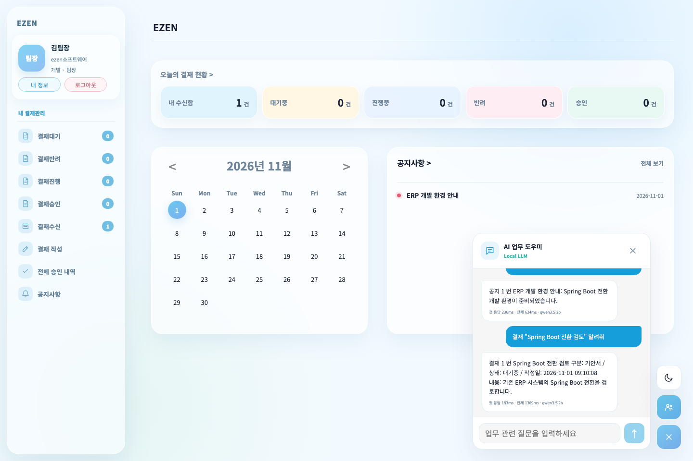

# 포트폴리오 시연: 업무 흐름과 검증 근거

작성 기준: 2026-11-01. 2025년 팀 프로젝트와 2026년 개인 개선을 구분하고, 대표 흐름을 2~3분 안에 보여 주는 순서다. 현재 제공 형태는 **단계별 시연 자료**이며 촬영 완료 영상으로 표시하지 않는다.

## 1. 격리된 화면 자료 재현

화면 자료는 JUnit이 만든 Testcontainers MySQL·임시 첨부·합성 계정으로 준비한다. 모델 답변은 브라우저 스트리밍 검증용 `browser-fixture`다. 실제 DB 조회·HTTP·SSE 화면을 검증하지만, 이 캡처를 실제 로컬 모델의 생성 품질 근거로 사용하지 않는다. 실제 모델은 [별도 비교 원문](ai-quality-browser-flows.md)을 따른다.

[README의 격리 회귀 준비](../../README.md#격리된-전체-회귀)를 마친 뒤 프로젝트 루트에서 실행한다. Docker Desktop이 필요하며 개발 DB를 사용하지 않는다.

```bash
ERP_DEMO_OUTPUT="$PWD/docs/refactoring/screenshots/portfolio-20261101" \
./mvnw --batch-mode -Dtest=BrowserFlowIntegrationTest test
```

기본 테스트를 다시 실행하며 성공한 장면 5개를 지정한 경로에 저장한다. 기존 캡처를 갱신하므로 당시 결과를 보관하려면 다른 출력 경로를 지정한다. 실패 시 저장된 일부 이미지로 전체 통과를 주장하지 않는다. 로그는 `target/browser-flow.log`, 실패 trace·영상 등은 `frontend/test-results`에 남긴다.

| 파일 | 장면 | 근거의 범위 |
|---|---|---|
| [workspace.png](screenshots/portfolio-20261101/workspace.png) | 로그인 뒤 대시보드 | 합성 계정의 실제 화면·API |
| [approval-completed.png](screenshots/portfolio-20261101/approval-completed.png) | 두 결재자의 순차 승인 후 상세 | 실제 MySQL의 문서·결재선·의견 |
| [messenger-read.png](screenshots/portfolio-20261101/messenger-read.png) | 메시지 읽음 상태 | 두 독립 브라우저 컨텍스트의 실제 WebSocket·DB·읽음 |
| [mobile-menu.png](screenshots/portfolio-20261101/mobile-menu.png) | 모바일 메뉴 | 키보드·포커스·닫힘 처리의 브라우저 회귀 |
| [ai-answer-fixture.png](screenshots/portfolio-20261101/ai-answer-fixture.png) | 부분 토큰 뒤 완료된 AI 답변 | 가짜 모델의 SSE 렌더·완료 표시. 실제 모델 품질과 구분 |

캡처는 합성 계정의 실제 실행 화면이다. 메신저 캡처에는 발신 화면의 읽음 표시가 있고, 모바일 캡처는 키보드 초점 표시를 포함한다. 브라우저 테스트는 캡처 전에 유한 CSS 전환을 완료시킨다.

### 실제 모델 화면

2026-11-01에는 별도 `.local-dev/portfolio-demo-20261101`의 native WAR·MySQL과 실제 Ollama `qwen3.5:2b`를 연결했다. 공지·결재·없는 자료·지원 범위 밖·인용 제목 뒤 `3줄로` 질문 5개가 통과했다. 원래 모델 답변의 사실 검사와 서버 조회 자료 라벨 검사를 구분했으며, HTTP 200·SSE done·화면 지표·입력 재활성화·브라우저 오류 0건을 확인했다.



[실제 답변과 SSE 원문](review-evidence/ai-browser-real-20261101.json) · [실행한 검증 코드](review-evidence/ai-browser-real-20261101.mjs) · [모델 반복 비교 32건](../../performance/results/ai-quality-20261101-cited/README.md)

이 검증 코드는 위 전용 native 루트와 `document/ERP.sql`의 합성 seed 계정만 사용한다. 새 복제본에서 README의 빌드·Ollama 준비를 마친 뒤 아래처럼 재현한다. 이미 생성한 환경은 `init`을 생략하며, 기존 source를 이 루트로 바꿔 쓰지 않는다. 재실행하면 같은 날짜의 JSON·캡처를 갱신하므로 기존 근거를 보관하려면 먼저 별도로 복사한다.

```bash
python3 scripts/dev-environment.py --root .local-dev/portfolio-demo-20261101 init
ERP_AI_BASE_URL=http://127.0.0.1:11434 ERP_AI_MODEL=qwen3.5:2b \
python3 scripts/dev-environment.py --root .local-dev/portfolio-demo-20261101 start
node docs/refactoring/review-evidence/ai-browser-real-20261101.mjs
python3 scripts/dev-environment.py --root .local-dev/portfolio-demo-20261101 stop
```

단계별 캡처 6장은 실제로 열어 배치·문자·계정 정보를 검사했다. E2E 계정과 native seed 이름은 합성 자료이며 실제 직원 개인정보가 아니다. 동영상은 촬영하지 않았다.

## 2. 2~3분 시연 순서

다음은 수동 시연·촬영 순서다. 로그인과 계정 전환을 미리 준비하고, 처리·읽음·AI 완료는 실제 화면 변화까지 기다린다.

| 구간 | 조작 | 보여 줄 결과·설명 |
|---|---|---|
| 0:00~0:15 | 기안자 대시보드를 연다 | “2025년 팀 프로젝트에 2026년 개인 개선을 진행했습니다. 업무 규칙·권한·실시간 통신을 실제 요청으로 확인했습니다.” |
| 0:15~0:45 | 결재 작성 → 두 결재자 지정 → TXT 첨부 → 등록 | 등록 순서와 대기 상태, 첨부 이름이 보인다. 2차 결재자는 앞 순서 승인 전 승인 버튼이 없다. |
| 0:45~1:10 | 1차 → 2차 승인 → 작성자 상세에서 첨부 다운로드 | 진행중 → 최종 승인, 처리 의견·순서와 첨부가 남는다. 동시 요청·거부 조건은 회귀 기록으로 연결한다. |
| 1:10~1:35 | 발신자 전송 → 수신자 미읽음 배지 → 해당 대화방 열기 | 발신자 `안 읽음` → `읽음`. 닫힌 패널은 자동으로 읽지 않고 새로고침 후 이력이 유지된다. |
| 1:35~2:10 | AI에 공지 요약·현재 대기 결재 질문 | 권한·질문에 맞는 제목·번호, 완료 뒤 모델·첫 응답·전체 시간이 보인다. fixture 화면과 실제 모델을 구분한다. |
| 2:10~2:35 | 모바일 메뉴 열기 → Tab → Escape / 사원 이름 링크에 Tab → Enter | 메뉴의 키보드 이동·닫기와 초점 복귀, 사원 상세 진입 |
| 2:35~2:50 | README의 검증·성능 근거를 연다 | “1천 건·3반복의 로컬 합성 측정이며 최대 수용 인원이나 운영 SLA를 뜻하지 않습니다.” |

모든 장면을 한 영상에 넣기 어려우면 결재·메신저·AI를 중심으로 2분, 키보드·부서 변경은 보충 캡처로 제시한다. 실제 동영상 파일이나 공개 영상 URL을 만들기 전에는 영상 링크를 추가하지 않는다.

## 3. 수동 재현용 native 환경

실제 모델과 계정 변경을 직접 시연하려면 [README 실행 조건](../../README.md#로컬-실행)을 준비한다. 기존 개발 DB 대신 `.local-dev` 바로 아래 새 환경을 사용한다. 다음 이름은 예시이며 비어 있는 경로에서 한 번만 초기화한다.

```bash
npm --prefix frontend ci
npm --prefix frontend run build
./mvnw --batch-mode -DskipTests package
python3 scripts/dev-environment.py --root .local-dev/portfolio-demo init
python3 scripts/dev-environment.py --root .local-dev/portfolio-demo start
python3 scripts/dev-environment.py --root .local-dev/portfolio-demo status
```

`status`의 URL을 연다. 작성자·1차 결재자·2차 결재자·관리자는 **서로 다른 브라우저 프로필/독립 컨텍스트**로 로그인한다. 같은 프로필의 일반 탭은 쿠키를 공유하므로 계정 분리에 사용하지 않는다. 기존 `.local-dev/source`를 초기화하거나 기존 파일을 지우지 않는다.

초기 관리자는 `admin` / `1234`다. 고정 비밀번호는 개발 fixture용이며 외부 배포 자격 증명이 아니다. 관리자 사원관리 화면에서 아래 역할을 만든다. 사원번호는 등록 완료 후 서버가 발급한 값을 기록한다. 첫 로그인 암호 변경은 촬영 전에 완료한다. 필수 연락처·생년월일은 공개용 합성 값을 사용한다.

| 역할·자료 | 준비 값 | 쓰는 장면 |
|---|---|---|
| 시연기안자 | 개발 / 사원 / 일반 사용자 / 재직 | 결재 작성, 메신저 발신 |
| 시연검토자 | 개발 / 대리 / 일반 사용자 / 재직 | 1차 승인, AI 대기 결재 |
| 시연승인자 | 개발 / 팀장 / 일반 사용자 / 재직 | 2차 승인 |
| 전사 공지 | `포트폴리오 공통 안내`, 전사 대상, 내용 `공통 확인 장소는 회의실 A입니다.` | AI 공통 자료 |
| 개발 공지 | `포트폴리오 개발 안내`, 개발 대상, 내용 `개발 확인 장소는 회의실 B입니다.` | 부서 변경 전 AI 자료 |
| 디자인 공지 | `포트폴리오 디자인 안내`, 디자인 대상, 내용 `디자인 확인 장소는 회의실 C입니다.` | 부서 변경 후 AI 자료 |
| 결재 첨부 | `portfolio-demo.txt`, 내용 `포트폴리오용 합성 첨부입니다.` | 업로드·다운로드 |

관리자 공지 등록 화면으로 공지 3개를 만든다. AI는 영역별 최신 최대 5건을 보므로 따옴표로 제목을 지정하면 seed 공지와 혼동하지 않는다. 부서별 공지는 **AI 문맥 범위** 확인용이다. 일반 공지 목록의 열람 정책과 동일하다고 설명하지 않는다.

메신저 발신자에서 시연검토자를 선택해 방을 만들고 수신자 패널을 닫아 둔다. 결재는 시연검토자 → 시연승인자 순으로 `포트폴리오 순차 승인`을 작성한다. AI용 `포트폴리오 AI 확인` 문서도 별도로 작성해 시연검토자의 대기 상태로 남긴다.

### 실제 모델 준비

Ollama를 설치한 환경의 별도 터미널에서 준비한다. 이미 실행 중이면 `serve`를 다시 실행하지 않는다.

```bash
ollama serve
```

서버가 준비되면 다른 터미널에서 `ollama pull qwen3.5:2b`를 실행한다. 이미 설치한 모델이면 생략한다.

기본 주소는 `http://localhost:11434`, 모델은 `qwen3.5:2b`, `think=false`다. 앱 시작 전에 `ERP_AI_BASE_URL`, `ERP_AI_MODEL`로 바꿀 수 있다. native 수동 시연은 테스트 전용 모델·오류 유도 경로를 사용하지 않는다.

## 4. AI 질문과 기대 결과

| 질문·상태 | 기대 결과 |
|---|---|
| `공지 "포트폴리오 개발 안내" 요약해줘` — 개발 계정 | 개발 공지 제목·번호와 회의실 B를 안내한다. 결재나 디자인 공지를 함께 요약하지 않는다. |
| `결재 "포트폴리오 AI 확인" 알려줘` — 현재 1차 결재자 | 현재 자기 순서인 대기 결재 안내. 앞 순서 승인 전 2차 결재자는 처리 대상이 없다. |
| `공지 "존재하지 않는 시연 공지" 알려줘` | 자료 없음 직접 안내. 다른 최근 공지로 대체하거나 모델을 호출하지 않는다. |
| `오늘 업무 우선순위 알려줘` | 우선순위를 확인할 수 없다고 안내하고 권한 내 자료를 직접 제시한다. 작성일을 긴급도로 추정하지 않는다. |
| `날씨 알려줘` | 공지·현재 본인 순서인 결재만 지원한다는 직접 안내 |

부서 변경 보충 장면은 시연검토자 로그인을 유지하고 관리자 프로필에서 개발 → 디자인만 변경한다. 같은 사용자 화면에서 새 질문을 보내 **개발 공지 제외·디자인 공지 포함**을 확인한다. 과거 채팅 메시지는 이전 답변으로 남을 수 있으므로 변경 후 새 요청을 비교한다. 로그아웃·재로그인으로 세션 경계 검증을 대신하지 않는다. 확정 결과는 [마감 검증 기록](portfolio-readiness.md)을 따른다.

### 모델 서버가 꺼졌을 때

모델 중단 상태에서 실제 자료가 있는 공지 요약을 요청하면 `로컬 AI가 응답하지 않습니다. 모델 실행 상태를 확인해 주세요.` 안내를 확인한다. `답변 생성 중` 표시가 끝나고 다른 ERP 기능은 계속 사용할 수 있어야 한다. 이는 **장애 처리 장면**이다. 자료 없음·우선순위·지원 범위 밖 질문은 직접 응답하므로 모델 연결 실패 재현에 사용하지 않는다.

모델의 문장·시간은 실행마다 달라질 수 있다. 번호·제목·현재 상태·합성 장소를 DB 자료와 대조한다. 첨부 내용·전체 과거 문서·의미 검색은 챗봇 범위에 포함되지 않는다. 캡처 1장이나 지정 질문 검사로 모든 자연어 질문의 정확도를 주장하지 않는다.

## 5. 검증 기록과 촬영 후 정리

| 근거 | 기준일·범위 |
|---|---|
| [계정·결재·이력 보존](p1-session-approval-history.md) | 2026-10-22 실제 HTTP·MySQL·WebSocket 회귀 |
| [첨부·목록·암호·읽음·의존성](data-usability-performance.md) | 2026-10-22 Maven 80개 통과·선택 2개 생략, Chromium 9개·Node 7개 |
| [1천 건 측정 원문](../../performance/results/20261022T103945Z-2fe863/README.md) | 2026-10-22 동일 조건 3반복, API·SQL·메시지·브라우저 |
| [AI 모델 비교](ai-quality-browser-flows.md) | 2026-10-06 질문·권한·프롬프트 조건을 고정한 원문·실패·시간 |
| [현재 마감 상태](portfolio-readiness.md) | 부서 변경 후 AI·키보드·모바일·문서의 최신 상태 |

2026-11-01에는 실제 모델 평가를 포함한 Maven 85개 중 84개 통과·성능 1개 생략, Chromium 12개·Node 7개·프런트 빌드·WAR 패키징을 확인했다. 마지막 제목 경계 수정 후 관련 JUnit 2개와 Chromium 12개도 다시 통과했다. [통합 실행 근거](review-evidence/portfolio-20261101.json)를 따른다. 원격 CI는 이전 커밋의 성공이며 새 변경의 실행으로 표시하지 않는다.

일반 CI는 실제 모델이나 성능 부하를 요구하지 않는다. 이전 README의 팀 이미지는 현재 UI 캡처로 사용하지 않는다. 공개 자료에 비밀번호·실제 개인정보·생성 비밀 설정이 포함되지 않았는지 확인한다. 수동 시연을 마쳤다면 전용 환경을 종료한다.

```bash
python3 scripts/dev-environment.py --root .local-dev/portfolio-demo stop
```
